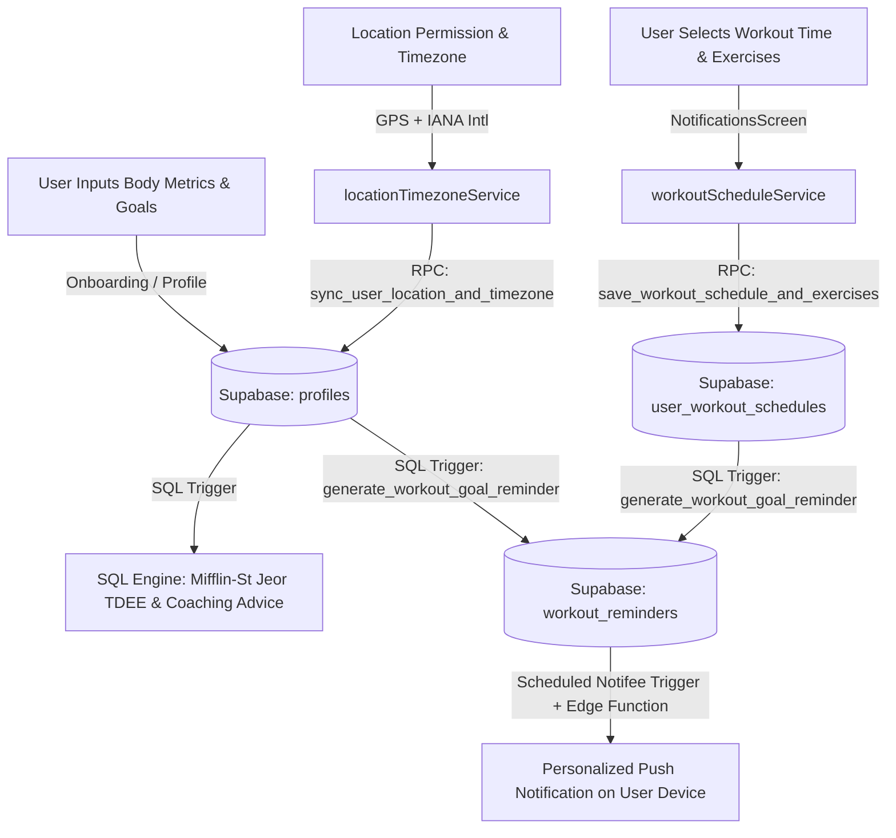

# Athleo Backend Architecture: Location, Timezone, Workout Schedule & Goal Reminders

## 1. System Overview

This system closes the loop between **user body metrics & fitness goals**, **automatic geolocation & timezone resolution**, **custom workout & exercise scheduling**, and **personalized push reminder notifications** backed by Supabase.

---

## 2. Supabase Database Schema

Migration file: [`supabase/migrations/202610200001_user_timezone_location_reminders.sql`](file:///d:/Athleo%206/Athleo/supabase/migrations/202610200001_user_timezone_location_reminders.sql)

### 2.1 Profiles Table (`public.profiles`) Extensions
| Column | Type | Description |
|---|---|---|
| `timezone` | `text` (default `'UTC'`) | IANA Timezone (e.g. `'Asia/Karachi'`, `'America/New_York'`) |
| `country` | `text` | Country name (e.g. `'Pakistan'`, `'United States'`) |
| `country_code` | `text` | ISO 2-letter country code (e.g. `'PK'`, `'US'`) |
| `region` | `text` | State, province, or subdivision (e.g. `'Punjab'`, `'Sindh'`) |
| `city` | `text` | City (e.g. `'Lahore'`, `'Karachi'`) |
| `latitude` | `numeric(9,6)` | GPS latitude coordinate |
| `longitude` | `numeric(9,6)` | GPS longitude coordinate |
| `location_permission` | `text` | Permission state (`'granted'`, `'denied'`, `'fallback_device'`) |
| `location_updated_at` | `timestamptz` | Timestamp of last location synchronization |

### 2.2 Workout Schedules Table (`public.user_workout_schedules`)
| Column | Type | Description |
|---|---|---|
| `id` | `uuid` (PK) | Unique schedule identifier |
| `user_id` | `uuid` (FK) | Unique reference to `public.profiles(id)` |
| `workout_time` | `text` | Time string (e.g. `'07:00 AM'`) |
| `workout_days` | `text[]` | Array of scheduled days (e.g. `['Monday','Wednesday','Friday']`) |
| `selected_exercises` | `jsonb` | Chosen exercises: `[{id, name, target, bodyPart, sets, reps}]` |
| `reminder_enabled` | `boolean` | Whether reminder notifications are active |
| `timezone` | `text` | Local timezone used for scheduling |
| `country` / `region` / `city` | `text` | Localized territory |

### 2.3 Workout Reminders Table (`public.workout_reminders`)
| Column | Type | Description |
|---|---|---|
| `id` | `uuid` (PK) | Reminder record identifier |
| `user_id` | `uuid` (FK) | Reference to `public.profiles(id)` |
| `title` | `text` | Notification title (e.g. `🏋️ Time to Train (07:00 AM) — Fat Loss`) |
| `body` | `text` | Personalized body containing goal, exercises, and app suggestion |
| `goal_snapshot` | `text` | Goal summary with current & target weights |
| `suggestion_snapshot` | `text` | App recommendation (calories, protein, coaching tip) |
| `exercises_snapshot` | `jsonb` | Routine exercises |
| `scheduled_time` | `text` | Local time (e.g. `'07:00 AM'`) |
| `scheduled_for` | `timestamptz` | Calculated next delivery UTC timestamp |
| `status` | `text` | `'scheduled'`, `'sent'`, `'delivered'`, `'dismissed'` |

---

## 3. Database Triggers & Stored Procedures (RPCs)

### 3.1 `public.generate_workout_goal_reminder(p_user_id uuid)`
- Automatically reads:
  1. User body metrics (`weight_kg`, `target_weight_kg`, `primary_goal`, `display_name`).
  2. Generated nutritional targets (`calorie_target`, `protein_target_g` from `user_targets`).
  3. User workout schedule & selected exercises (`user_workout_schedules`).
- Synthesizes a high-impact notification:
  - **Goal Confirmation**: *"Goal: Fat Loss & Conditioning (Current: 78 kg → Target: 72 kg)"*
  - **Exercises**: *"Today's Focus: Barbell Back Squat, Push-up, Lat Pulldown"*
  - **App Recommendation**: *"App Suggestion: Daily target 2,050 kcal, 156g protein. Maintain progressive overload and proper hydration."*
- Inserts into `public.workout_reminders` with status `'scheduled'`.

### 3.2 Automated Triggers
- **`trg_profile_fitness_change_reminder`**: Automatically recomputes the reminder whenever the user updates their weight, height, goal, target weight, or timezone in `profiles`.
- **`user_workout_schedules` trigger**: Recomputes the reminder whenever the user modifies their workout time, days, or routine exercises.

### 3.3 Client RPCs
- **`public.sync_user_location_and_timezone(...)`**: Atomically updates location, timezone, country, and region on `profiles` and `user_workout_schedules`.
- **`public.save_workout_schedule_and_exercises(...)`**: Upserts workout time, days, and routine exercises, and returns the generated reminder.
- **`public.get_user_workout_schedule()`**: Returns the full profile location, schedule, macro targets, and latest reminder.

---

## 4. Mobile Client Architecture

### 4.1 Location & Timezone Service ([`src/services/locationTimezoneService.ts`](file:///d:/Athleo%206/Athleo/src/services/locationTimezoneService.ts))
- **Permission handling**: Requests fine location permission via Android `PermissionsAndroid` and iOS Geolocation.
- **Timezone resolution**: Uses native `Intl.DateTimeFormat().resolvedOptions().timeZone` to obtain precise IANA timezone (e.g. `Asia/Karachi`, `America/New_York`).
- **Reverse geocoding**: Obtains GPS coordinates and reverse geocodes country, country code, region/subdivision, and city.
- **Offline heuristics**: Includes instant fallback tables for timezone-to-region mapping.
- **Supabase sync**: Syncs to backend via `sync_user_location_and_timezone`.

### 4.2 Workout Schedule Service ([`src/services/workoutScheduleService.ts`](file:///d:/Athleo%206/Athleo/src/services/workoutScheduleService.ts))
- Maintains schedule state, workout days, and selected exercises.
- Interfaces with `@notifee/react-native` through `scheduleCustomWorkoutReminder` to queue native local notifications.
- Syncs bidirectional updates with Supabase.

### 4.3 Notifications Screen ([`src/screens/NotificationsScreen.tsx`](file:///d:/Athleo%206/Athleo/src/screens/NotificationsScreen.tsx))
- **Live Location Card**: Displays detected country, region, timezone, and GPS accuracy status with a manual re-sync button.
- **Reminder Time Chips**: Allows quick selection between common training times (`06:00 AM`, `07:00 AM`, `08:00 AM`, `05:00 PM`, `06:00 PM`, etc.).
- **Workout Days Selector**: Interactive day pills (Mon–Sun).
- **Exercise Selector & Catalog**: Visual pills for selected routine exercises and tap-to-add from the exercise library.
- **Live Notification Preview Card**: Renders a mockup of the exact push notification the user will receive.
- **One-tap Sync Button**: Saves to local cache, schedules native Notifee trigger, and pushes to Supabase.
